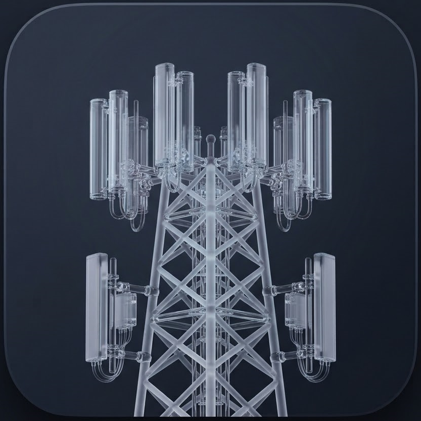

# Cell & IoT Network Survey Diagnostics

<p align="center">
  
</p>


A high-precision cellular network telemetry and site survey application built with Flutter. Designed for hardware engineers, IoT system integrators, and network technicians to audit field locations, evaluate primary and neighboring tower signal characteristics, and verify cellular viability before deploying cellular IoT devices.

## Features

1. **Full Radio Diagnostics (Full Diagnostics)**
•	**SIM & Operator Inspection:** Displays SIM hardware carrier name, MCC (Mobile Country Code), and MNC (Mobile Network Code).
•	**Multi-RAT Support:** Audits primary and neighboring cell towers across LTE, 5G NR, WCDMA, and GSM networks.
•	**Deep Parameter Telemetry:**
o	**Cell Identifiers:** Physical Cell ID (PCI), Cell ID (CID / NCI), Tracking Area Code (TAC), E-UTRAN Cell Identifier (ECI), and eNodeB ID (eNB).
o	**Frequency & Bandwidth:** Downlink EARFCN / NR-ARFCN and operational channel bandwidth.
	**Signal Metrics:** RSRP, RSRQ, RSSI, and SNR / SINR.
•	**Interactive Metric Guide:** Tap any metric card to open a technical reference modal displaying 3GPP operational limits and quality thresholds.

2. **Signal Quick Compare (Signal Summary)**
•	**Side-by-Side Cell Comparison:** Rapidly compare primary serving cell metrics against adjacent neighboring cells.
•	**Compact Matrix Layout:** Displays PCI, EARFCN, RSRP, RSRQ, RSSI, and SNR in color-coded tiles for instant evaluation during movement.

3. **Interactive Signal Map (Map View)**
•	**OpenStreetMap Integration:** Live mapping interface using flutter_map and latlong2.
•	**Dynamic Location Marker:** Pinpoints current GPS coordinates with a multi-ring marker color-coded to match the primary serving cell's real-time RSRP signal quality.
•	**Marker Clustering:** Grouped spatial clusters via flutter_map_marker_cluster for clean visualization during high-density surveys.

4.**Continuous Data Logger & CSV Export (Data Logger)**
•	**Configurable Sampling Rate:** Set polling intervals at 1s, 2s, 3s, 5s, 10s, 30s, or 60s.
•	**Foreground Recording HUD:** Persistent global recording banner indicating active duration, sampled row count, and capture frequency.
•	**Multi-Cell Array Capturing:** Logs primary and neighboring cell records paired with concurrent GPS telemetry per sample interval.
•	**CSV File Export:** Compiles recorded drive-test and static survey logs into a structured CSV file and opens the native system share sheet (share_plus).

## Signal Quality Thresholds

Metrics are dynamically color-coded across all views based on the following standard wireless signal health classifications:

|Metric	|Excellent (Green)	|Good (Light Green)	|Fair (Orange)	|Poor (Red)|
|---|---|----|---|---|
|RSRP	|$\ge -80\text{ dBm}$	|$-80\text{ to }-90\text{ dBm}$	|$-90\text{ to }-105\text{ dBm}$	|$< -105\text{ dBm}$|
|RSRQ	|$\ge -10\text{ dB}$	|$-10\text{ to }-15\text{ dB}$	|$-15\text{ to }-20\text{ dB}$	|$< -20\text{ dB}$|
|RSSI	|$\ge -65\text{ dBm}$	|$-65\text{ to }-75\text{ dBm}$	|$-75\text{ to }-85\text{ dBm}$	|$< -85\t|

## Exported CSV Data Schema

When exporting logs from the Data Logger, the resulting CSV file contains the following structure per entry:

|Column Name	|Description	|Example|
|---|---|---|
|Timestamp	|ISO 8601 UTC string	|2026-10-01T14:30:00.000Z|
|Latitude / Longitude	|GPS coordinates	|-30.8598, 30.02184|
|Accuracy(m)	|Horizontal GPS accuracy in meters	|3.2|
|Altitude(m) / AltitudeAccuracy(m)	|Altitude above sea level and vertical accuracy	|104.5, 1.2|
|Speed(m/s) / SpeedAccuracy(m/s)	|Movement velocity and accuracy	|0.0, 0.1|
|Heading(deg)	|Direction of travel in degrees	|180.0|
|CellRole	|Network hierarchy classification	|Primary or Neighbor|
|CellType	|Radio Access Technology	|LTE, NR, WCDMA, GSM|
|ConnectionStatus	|Cell connection status	|1 (Connected) / 0 (Non-connected)|
|PCI	|Physical Cell Identity	|142|
|EARFCN_NRARFCN	|Downlink channel number	|1300|
|CID_NCI	|Unique Cell Tower Identifier	|268435456|
|TAC	|Tracking Area Code	|4101|
|ECI / eNB	|E-UTRAN ID / Base Station ID	|1048576, 4096|
|Bandwidth	|LTE/NR Channel Bandwidth (kHz)	|20000|
|RSRP(dBm)	|Reference Signal Received Power	|-88|
|RSRQ(dB)	|Reference Signal Received Quality	|-11|
|RSSI(dBm)	|Received Signal Strength Indicator	|-62|
|SNR(dB)	|Signal-to-Noise Ratio	|18.5|

## Tech Stack & Architecture

•	**Framework:** Flutter (Dart) with Material 3 Dark Theme.
•	**State Management:** signals_flutter for fine-grained reactive state and UI updates.
•	**UI Animations:** cue for motion transitions and active recording banners.
•	**Cellular Telephony API:** flutter_cell_info for Android TelephonyManager hardware integration.
•	**Location Services:** geolocator for high-accuracy continuous GPS streaming.
•	**Mapping Engine:** flutter_map + flutter_map_marker_cluster on OpenStreetMap tiles.
•	**Permissions:** permission_handler for runtime permission management.
•	**Exporting & Sharing:** path_provider and share_plus.

## Prerequisites & Setup

This application relies on low-level Android Telephony APIs to read raw cell tower information.
1. Platform Requirements
•	**Platform:** Android only (iOS restricts access to raw cell measurement data and Telephony APIs).
•	**Target Android API:** Level 24 (Android 7.0) or higher recommended.
2. Android Manifest Permissions
Ensure the following permissions are declared in your android/app/src/main/AndroidManifest.xml:

```
XML
<uses-permission android:name="android.permission.ACCESS_FINE_LOCATION" />
<uses-permission android:name="android.permission.ACCESS_COARSE_LOCATION" />
<uses-permission android:name="android.permission.READ_PHONE_STATE" />
```
3. Execution
    1.	Enable Location (GPS) on the target device.
    2.	Ensure an active SIM card is inserted into the Android device.
    3.	Grant Fine Location and Phone State permissions when prompted at application launch.
